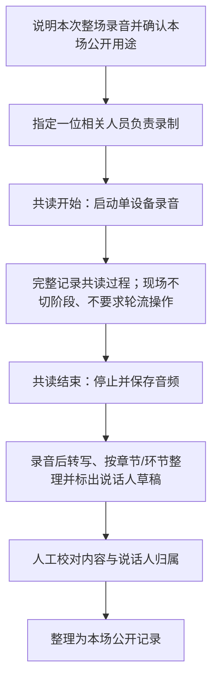

# 线下共修流程与自愿记录：概念 Spec

> 2026-11-06 更新：本文件保留历史线下活动概念；当前产品不计划自建录音或转写，频道导入采用 [AgentBot 导入 Spec](./channel-agent-import-spec.md)。该 Spec 对游客提交、自动公开和整理规则的决定优先于本文相关设想。

- 状态：讨论稿 v0.1（后续 Feature，非 MVP）
- 日期：2026-11-01
- 依据：[产品 Proposal](./proposal-spec.md)、[设计指导 Spec](./design-guidelines-spec.md)、[技术架构 Spec](./technical-architecture-spec.md)
- 目标：将线下共修过程及其录音、整理稿默认公开，并按章节整理沉淀；不把现场记录操作交给每位参与者

## 1. 线下流程基线

一次约两小时的共读通常包含：

1. 静心：约 10 分钟观想、静坐、感受呼吸。
2. 领读分享：当天唯一领读人领读一个章节并分享理解与体会。
3. “三生万物”：约三人一组，围绕有感触的文字交流约 10—15 分钟。
4. 小组代表发言：代表依次分享小组观点。
5. “听别人故事，悟自己人生”：分享真实生活场景与心得。
6. 简短发言与合影：参与者简短收尾并合影。

这是现有线下活动的参考结构，不要求产品把六个环节变成强制任务或计时器。

### 1.1 活动现场 Workflow（MVP 验证基线）

现场采集按所有活动默认公开的产品原则实施：由一位相关人员负责录音，可以是领读人、参与者、MVP 验证者或助理；开始共读时启动录音，记录完整共读过程，结束后停止并保存音频。现场不要求参与者轮流操作，也不依赖阶段识别、自动暂停或复杂状态机。阶段标签和说话人分段在录制后转写整理时生成，作为可校对的草稿。



`三生万物`和`各组代表分享`仍可作为录音后的两个独立整理标签；当前验证基线是录下完整过程，不在现场因环节变化而暂停/恢复。转写和切段只用于整理与检索，不自动确认发言者身份或内容准确性；本验证 case 已确认整场公开用途。

## 2. 核心领域模型：活动是场域主体

未来线下互动应以一场 `GatheringEvent`（共读活动）作为聚合主体，不再把散落的用户提交当作活动本身。活动 ID 是人员、环节、小组、录音、发言片段、认领收获和章节内容之间的关联锚点。活动记录/提交仍可保留为原始行为与审计条目，但不替代活动实体。

概念关系：

```text
道场 ──< 共读活动 >── 章节
          ├── 发起人 / 领读人
          ├── 参与者与到场状态
          ├── 小组与小组成员（可选）
          ├── 录音会话 → 说话片段（临时说话人标签）
          └── 活动录音与整理稿 → 校对后公开展示
```

建议分开建模：`GatheringEvent`（活动主体）、`EventParticipant`（参与和到场关系）、`EventGroup` / `EventGroupMember`（小组与成员）、`RecordingSession`（录音源）、`SpeakerSegment`（转写/说话人片段）、`ClaimedTakeaway`（由参与者认领的个人收获）。这些仅为后续逻辑实体建议，不进入 MVP 数据库。活动仍建议一个章节对应一场活动；若一次线下共修会读多章，应另行确定是一个活动多章还是拆成多个活动。

活动可包含可选日程和状态，如草稿、开放参与、进行中、已结束、取消；参与者登记/到场状态是活动功能的一部分。活动及其录音、整理稿默认公开；AI 转写、摘要、检索等模型处理用途仍按具体功能说明。

## 3. 产品假设与记录模式

### 3.1 设计目标

将共读活动的录音和整理内容关联到章节、道场/活动和发言环节；活动记录、录音和经校对的整理稿默认公开，帮助后来者理解经典如何与真实生活发生联系。

### 3.2 单人负责的整场录制

- **一位相关人员负责录音**：可以是领读人、参与者、MVP 验证者或助理。由此人使用一台设备，在共读开始时启动、结束时停止，记录完整共读过程；参与者不需要轮流操作手机，也不需要现场维护阶段状态。音频统一关联本场活动/验证 case。
- **本场内容沉淀**：整场音频及经人工校对的文字整理作为本场公开记录。
- **说话人整理**：录音后的转写可先使用“说话人 A/B/C”等临时标签；整理时校正发言归属，不在现场要求参与者认领片段。
- **录音范围**：所有共读活动按整场连续录制，包括静心、领读、小组交流、代表分享及收尾等环节；活动录音和整理稿默认公开，不设计逐环节或逐人状态管理。

所有活动默认公开整场音频与经校对的文字整理；AI 转写和整理内容仍须人工核对，尤其是人名、经典引文、说话人归属和语义可能有误之处。

整场录音用于公开记录；录音不等同于转写准确或整理稿已经校对。公开整理稿前应完成内容核对，避免把模型误识别内容作为参与者原话发布。

### 3.3 本场公开记录处理流程

```text
一台设备录制整场 → 音频素材 → 转写与说话人分段草稿
    → 人工校对内容、引文和说话人 → 整理成本场公开记录
```

- 说话人分离先只生成“说话人 A/B/C”等活动内临时标签；这叫说话人分段，不是身份识别。整理稿的说话人归属可人工校对。不得把声纹相似度当成真实身份认证，也不默认长期保留声纹模板。
- 原始音频和模型生成文本保留来源关联；转写不能覆盖原始音频。
- AI 输出是待核对草稿，不自动归为领读人定稿、经典注解或平台观点。
- 活动原始录音、转写和整理稿均属于活动公开记录；发布前校对转写准确性、经典引用和说话人归属。
- 活动相关内容默认进入公开频道及未来公开检索；发布后可按通用内容管理规则隐藏或逻辑删除。
- 活动及录音默认公开；AI 转写和整理稿作为编辑草稿，完成校对后公开。发布后可按通用内容管理规则隐藏或逻辑删除。
- 分享可按已确认规则选择匿名身份或公开昵称；声音本身可能识别说话者，匿名展示不等于音频匿名。

### 3.4 章节和环节标签

未来记录可带有：活动 ID、章节 ID、作者账号、参与者状态、活动小组 ID、环节标签、采集时间、媒体源 ID、说话人临时标签、认领状态、发布状态、转写状态和分享者确认时间。环节标签建议为：`LEAD_READING`、`SMALL_GROUP`、`GROUP_REPRESENTATIVE`、`LIFE_STORY`、`CLOSING_REFLECTION`。静心环节不建议采集个人观想内容。

当前 MVP 仍是一人一次的原始活动提交，不自动合并。未来活动实体将作为新阶段模型演进，不追溯性地把 MVP 的多条原始提交自动改写为一条活动。数据模型应保留旧记录与新活动实体之间的来源和关联历史。

活动有稳定 ID 后，录音、签到、人员小组和发言片段才能围绕同一场域可靠关联。该 ID 应源于真实活动对象，而不是根据地点/章节/时间猜测；签到仅表示参与关系，不改变活动内容默认公开的规则。

## 4. 第一轮体验原型要验证什么

- 手机不操作也能完整参加线下共修；现场录音不要求参与者操作手机。
- 负责录制的人能否用最少操作完成整场录音，并在结束后找到对应音频素材。
- 录音后能否把整场内容整理成准确、易读且保留真实现场经验的公开记录。
- AI 分段是否足够准确，整理者能否校对说话人归属并修正错误。
- 转写和整理能否在录音后识别领读、三人小组、代表发言与生活分享等内容，而不要求现场人员维护阶段流程。

不要用录音条数、转写字数或上传时长作为价值指标。观察整理稿是否忠实记录真实经验，以及后来的读者是否认为这些分享提供了新的生活视角。

## 5. 后续实施拆分建议

1. **活动主体与签到**：活动发起/发布、章节和道场关联、参与者报名/到场、可选小组管理；活动及其记录默认公开。
2. **单人负责录音**：一位相关人员启动和结束整场录音，音频作为公开活动记录保存；MVP 不做现场分阶段状态机。
3. **转写与整理**：录音后生成转写、说话人分段与活动整理稿，校对后公开。
4. **AI 整理与结构化检索**：经单独评审授权后做摘要/主题整理；只有公开且确认的内容进入公共检索。

以上均不属于当前 MVP；可按阶段分别上线。活动与签到不依赖录音，录音不依赖 AI。

## 6. 编码前需由产品负责人明确的原则

1. **活动创建权和字段**：谁可发起活动、是否需主理人权限、一个活动是否只能有一个章节、开始/结束和取消状态如何记录？
2. **报名与到场的关系**：是否允许未报名者签到？签到是否只需本人确认，是否保留签到时间和撤销记录？签到数据的公开范围是什么？
3. **录音后整理范围**：三人小组交流等多人重叠发言的转写和说话人分段准确率是否达到可用标准？若不足，MVP 是否先只整理清晰可辨的领读与代表发言？
5. **声音与身份分离**：说话人分段只是活动内标签，不以声纹自动确认真实身份；整理稿中说话人归属需可人工校正。
6. **AI 处理范围**：公开活动内容不等于自动授权模型训练；摘要、搜索索引、问答引用等用途按具体功能说明。
7. **活动结束后的即时价值**：参与者希望活动结束后多久看到公开整理稿？AI 未完成或分段不准时，是否提供原音/人工整理的降级路径？

