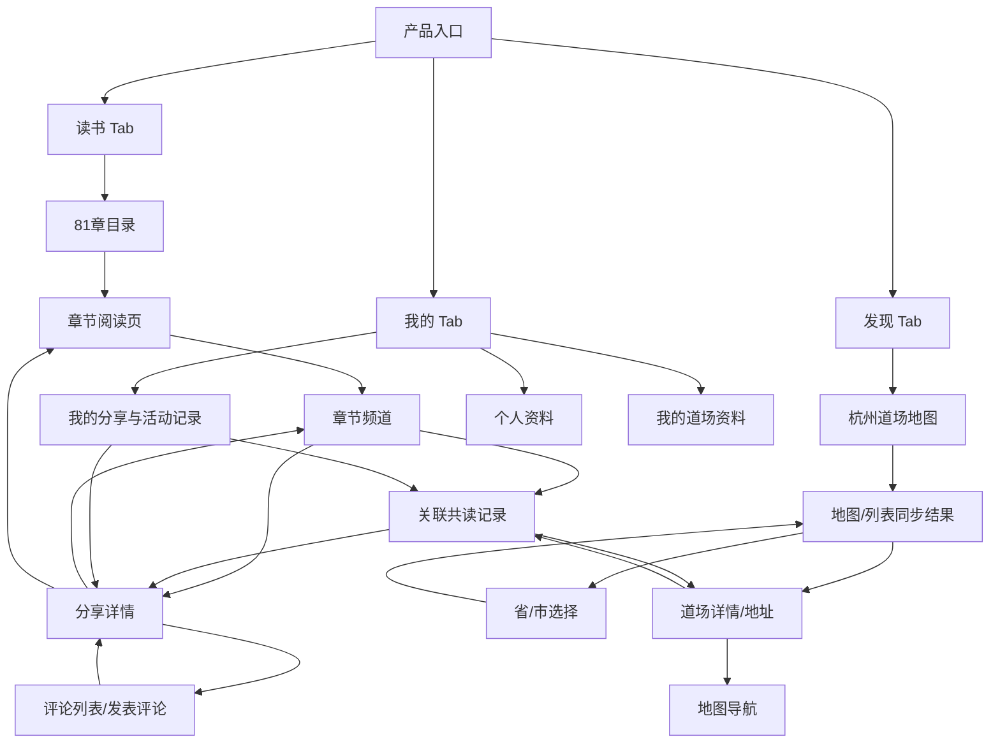
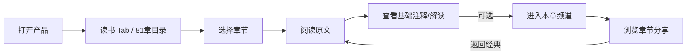
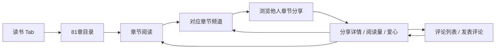
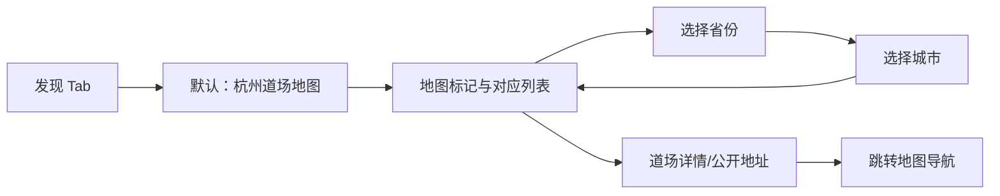
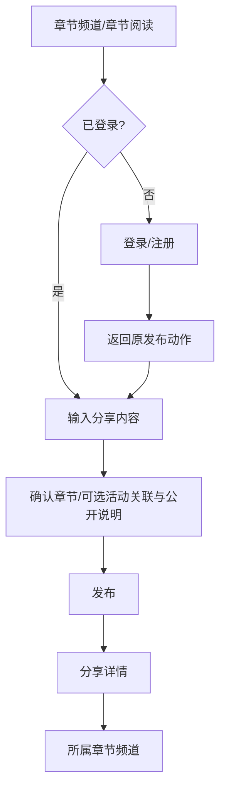
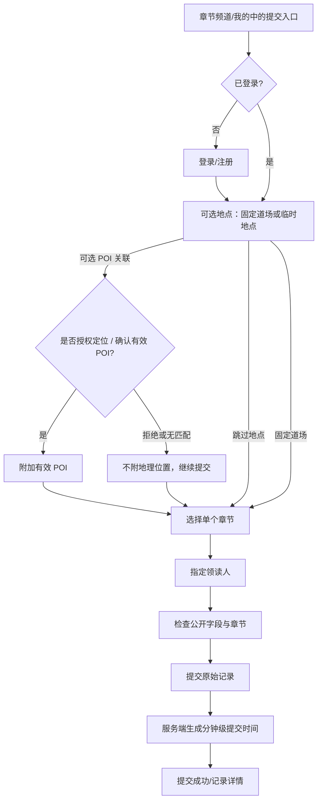

# 《道德经》共读平台：产品页面地图与动线 Spec

- 状态：MVP-1 基线候选 v0.2
- 日期：2026-11-01
- 更新：2026-11-03
- 依据：[主产品 Spec](./proposal-spec.md)、[设计指导原则](./design-guidelines-spec.md)、[技术架构 Spec](./technical-architecture-spec.md)
- 目的：明确首期页面职责、页面间关系、用户动线和跨端信息框架，作为线框图与交互原型的输入
- MVP 全页面低保真总览 Artifact（按 IA 与用户 Story 双维度覆盖）：[low-fi-prototype-map.html](./low-fi-prototype-map.html)
- 适用范围：响应式 Web 的移动端优先布局；不定义品牌视觉、高保真样式或 API 字段细节

## 1. 页面框架结论

一级导航为三个 Tab：**读书、发现、我的**。移动端打开产品默认进入“读书”；桌面端使用相同的主导航，但可将章节目录、正文和辅助信息并排呈现。

- **读书**是核心任务入口：目录 → 章节阅读 → 对应章节频道。
- **发现**首期只做道场到场发现：默认地图模式，可切换列表并按省/市查看地址；内容信息流、洞察推荐和其他主动内容发现暂不进入 MVP。
- **我的**管理用户资料和本人贡献：分享、活动记录、道场资料以及隐藏/删除等操作。
- **81 个章节频道**是按章节预置的稳定内容空间，不是活动频道。
- **活动记录、内容分享、道场资料**是不同业务对象，通过明确关联连接。一次活动只记录一个章节，不支持一次活动多章节提交。

## 2. 角色和访问基线

| 角色/状态 | 可浏览经典与公开内容 | 可发布分享 | 可提交活动记录 | 可维护道场资料 |
| --- | --- | --- | --- | --- |
| 未登录访客 | 可以 | 不可以；提示登录后继续 | 不可以；提示登录后继续 | 不可以 |
| 已登录用户 | 可以 | 可以；逐条选择匿名或公开昵称，公开仅有基础名称与头像；作者可发布后隐藏 | 可以；一次活动一个章节且记录唯一领读人，服务端生成分钟级提交时间；不展示提交数 | 创建者/主理人按权限维护 |
| 平台管理员/运营 | 可以 | MVP 不提供专用管理端 | MVP 不提供审核/合并后台 | 必要维护由项目负责人通过受控数据库操作完成 |

**定位行为**

- 道场地图和省市列表浏览不要求设备定位；MVP 不提供发现页附近距离排序。
- 定位仅为地图 POI 关联服务。用户拒绝授权或无法确认有效 POI 时可不提供地理信息继续完成所属章节的分享/记录；无 POI 内容不出现在地图点位中。
- 不做后台持续定位；MVP-1 不实现站内报名，站内报名属于 MVP-2。

## 3. 全局信息架构

## 4. 页面清单与页面职责

| ID | 页面 | 所属 Tab/层级 | 页面核心定位 | 关键出口 |
| --- | --- | --- | --- | --- |
| R01 | 读书首页/章节目录 | 读书 Tab | 展示 1—81 章目录、继续阅读位置、阅读入口及不带数字的章节热度点 | 章节阅读、章节频道 |
| R02 | 章节阅读 | 读书二级页 | 阅读指定版本的原文、基础注释和解读 | 上/下一章、目录、章节频道、发现 |
| R03 | 章节频道 | 读书二级页 | 聚合明确关联该章的站内公开分享；按有效阅读数/最新排序、阅读量、爱心和评论入口 | 阅读本章、分享详情/评论、发布分享（登录） |
| D01 | 发现道场（地图/列表） | 发现 Tab | 地图为默认视图；按省/市筛选固定道场与有有效 POI 的临时地点 | 道场详情、地图外跳 |
| D02 | 省/市选择与道场列表 | 发现二级页/状态 | 按省、市逐级选择并浏览道场地址 | 道场地图状态、道场详情 |
| C01 | 分享详情 | 通用内容页 | 展示正文/媒体、阅读量、爱心、评论摘要、来源和章节关联 | 所属章节频道、评论、关联活动记录 |
| C03 | 评论列表/发表评论 | 分享详情内分区或二级页 | 按时间展示单层评论并允许登录用户发表评论，沉淀评论互动数据 | 分享详情、登录后回跳原帖 |
| C02 | 发布分享 | 登录后的轻量编辑页/弹层 | 发布一段文字或媒体分享，章节可从当前上下文预填 | 分享详情、对应章节频道 |
| G01 | 活动记录提交 | 登录后的轻量流程 | 提交已发生的单章节共读记录；不管理报名签到 | 提交成功/活动记录详情、章节频道 |
| G02 | 活动记录详情 | 通用内容页 | 展示提交时间、章节、地点、内容关联和记录状态 | 章节频道、关联分享、道场详情 |
| V01 | 道场详情 | 通用内容页 | 展示道场地址、介绍、活动方式、公开联系方式和更新时间 | 地图外跳、关联活动/分享、维护资料（有权限） |
| M01 | 我的 | 我的 Tab | 个人资料入口与个人内容总览 | 我的分享、我的记录、道场管理、账号设置 |
| M02 | 我的内容 | 我的二级页 | 查看本人分享和活动提交，进入详情并管理 | 分享/活动详情、隐藏或删除操作 |
| M03 | 编辑个人资料 | 我的二级页 | 编辑展示名、内置头像；可选绑定并验证恢复邮箱 | 返回“我的” |
| M04 | 我维护的道场 | 我的二级页 | 查看本人创建/维护的固定道场并进入编辑 | 道场详情、道场资料编辑 |
| V02 | 创建/编辑道场资料 | 登录后的表单页 | 创建固定道场或编辑本人有权维护的资料，确认公开地址/地图位置 | 保存并返回道场详情或列表 |
| F01 | 建议与反馈 | 我的/帮助入口（位置待交互设计定案） | 提交产品建议并获得提交结果；自动保存为 VOC，不自动处理 | 提交成功/失败状态 |
| A01 | 登录/注册/找回密码 | 受限操作入口 | 完成手机号或邮箱注册登录；手机号账号通过短信验证码重置（每滚动 24 小时最多成功一次），邮箱账号通过已验证邮箱重置；恢复邮箱可选 | 返回用户原先尝试执行的动作 |

| 原型 ID | 对应页面/状态 | 类型 |
| --- | --- | --- |
| IA | 一级导航与全局页面关系 | 信息架构总览 |
| R01、R02、R02-C、R02-P、R02-M、R02-D、R02-N、R02-T、R02-F、R02-E、R03、R03-E | 目录、阅读、浮条、逐页翻阅、阅读菜单、目录层、浮层半屏、浮层顶部、字号设置、章节末页、频道分享、频道空状态 | 主页面/关键状态 |
| C01、C03、C02、C02-M、C02-S | 分享详情、评论列表/发表评论、发布、媒体选择/上传、发布完成 | 主页面/关键状态 |
| D01、D01-L、D02、D02-P、D02-C、V01 | 杭州地图、地图/列表态、地区、省份、城市、道场详情 | 主页面/筛选状态 |
| G01-A、G01-L、G01-B、G01-C、G02 | 地点、定位授权、章节选择、提交确认、记录详情 | 提交流程页面/权限状态 |
| M01、M02、M02-H、M02-D、M02-G、M03、M03-A、M04、V02 | 我的、分享列表、隐藏/删除、记录列表、资料、头像、道场列表、创建/编辑道场 | 主页面/管理状态 |
| A01-L、A01-R、A01-RP、A01-RE、A01-F、A01-N、A01-O、GATE | 登录、注册选择、手机号/邮箱注册、找回、短信重置额度提示、退出、登录回跳 | 账号页面/权限状态 |

**原型覆盖补充（页面线框与关键状态）**：低保真总览逐一展示上述页面，并将主页面之外的一期能力拆为独立线框：读书字号设置；频道空态；分享媒体选择/上传及发布完成；地图列表态、省份/城市选择；共读地点、定位授权拒绝、章节选择和提交确认；本人分享/共读列表、隐藏/逻辑删除确认、头像选择、道场列表与创建/编辑；手机号/邮箱注册、登录、密码找回、短信重置额度耗尽提示及登录后动作回跳。校验失败、请求失败、加载等系统反馈由逐页状态规格约束，不重复作为独立路由页面绘制。

**首期明确不列为页面/功能的内容**：发现 Tab 的通用内容信息流/洞察卡片、跨章节或个性化推荐、全网抓取/复制内容、活动报名与 RSVP、签到/二维码、未来活动日历、话题论坛、楼中楼评论、关注/私信、运营精选管理、活动合并后台、统计看板、运营管理端、AI 问答、现场语音录制与 AI 转写整理。线下录制作为后续独立 Feature，见[线下共修流程与自愿记录概念 Spec](./offline-gathering-capture-concept-spec.md)。分享浏览仍属于读书路径：用户从章节阅读页进入对应章节频道，在频道内查看他人分享。

## 5. 核心页面信息框架

### R01 读书首页 / 章节目录

1. 顶部：产品名称/轻量导航、必要的账号入口。
2. 继续阅读：以目录上方的轻量进度行呈现最近章节（首次访问时可不显示），不占用大块推荐卡片。
3. 章节目录：第 1—81 章按序排列，显示章节号和版本中存在的章名。章名旁可显示一个小型空心圆点，底色由透明渐变为传统青色，表达后台累计章节阅读与公开分享互动形成的热度；不显示次数、排名或评价性文案。热度接口失败时隐藏圆点，不影响目录。
4. 每章入口：主点击进入阅读；次级明确入口进入该章频道。
5. 目录状态：加载、空数据、章节内容暂不可用、最近阅读位置。

移动端以书籍目录式章节索引和连续滚动为主，用留白/细线而非逐章卡片区隔；桌面端可采用章节侧栏加阅读主栏。目录不混入推荐卡片流。

### R02 章节阅读

1. 章节导航：目录、章号和更多菜单轻量可见；阅读正面左右滑逐页翻阅，章节边界可继续进入相邻章节，并提供等价按钮。阅读时隐藏全局 Tab，返回读书后恢复。
2. 原文区：单列分页书页，明确章号、真实版本/来源与原文；不拆成卡片。
3. 章节浮层：常驻底部、非模态，具收起/半屏/顶部三档；从把手拖动或点击控制高度。浮条轮换当前章注释或按有效阅读数排序的分享；展开可切换「注释 / 本章分享」并进入频道。注释先「当代注释」再「河上公」，保留来源和各层待补状态。
4. 阅读控制：字号收进更多菜单，调整后保持文字锚点；匿名用户同一浏览器可恢复最近阅读位置。
5. 频道入口：每章浮层展示按有效阅读数排序的分享预览和频道入口，原文末页提供摘要或空态及频道入口；返回阅读时恢复位置。切章后浮层跟随当前章，不展示旧章内容。第 1/81 章缺失方向禁用，不循环。

移动端交互、视觉变量、竞品与验证详见 [移动端阅读体验 Spec](mobile-reading-experience-spec.md)。

### R03 章节频道

1. 频道标题：章号/章名、阅读原文入口。
2. 章节内容流：默认按有效阅读数排序，提供“最新”切换；只显示明确关联当前章的站内公开分享，外部内容以来源链接呈现，不抓取全网。内容条目显示作者、时间、内容类型、来源、有效阅读量、爱心数和评论数；以正文排版和轻分隔线分组，不统一套边框卡片。
3. 互动：登录用户可给分享点爱心并发表评论；未登录点击时进入登录，成功后回到原帖/原操作。评论默认为纯文字单层，按时间顺序显示。
4. 发布入口：已登录用户可发起分享，默认关联当前章；未登录用户触发登录并回到原操作。
5. 有效阅读数排序是章节范围内的分享排序，不是“优质/权威”判断；活动关联与分享分区展示，首期不提供话题论坛、楼中楼或成员名册。

### D01/D02 发现道场：地图与省市列表

1. **默认状态**：打开“发现”即显示道场地图，初始城市为杭州；不先展示分享流、洞察卡片或推荐内容。
3. **地图模式**：显示固定道场以及关联有效 POI 的临时地点，清楚标注类型；一期重点覆盖杭州，并允许把地图平移/区域切换到浙江其他城市。
4. **列表模式**：地图与列表共用同一筛选结果。列表提供省份和城市的层级选择；一期默认浙江省 → 杭州市，并可继续选其他已收录省市。
5. **地图/列表联动**：选择标记或列表项时高亮同一道场；列表选择让地图定位该道场。地图缩小导致标记密集时聚合显示。
6. **道场卡片**：列表显示道场名称、城市/片区、活动方式和简短介绍；进入详情后查看公开地址、联系方式、最近更新时间和地图导航入口。
7. **覆盖范围**：杭州约 20 个道场是一期首批资料梳理目标，不是系统上限。上线前核验每个道场的名称、省市/区、公开地址、经纬度、坐标来源、活动方式、联系方式和资料更新时间。
8. **临时地点也可发现**：已关联有效 POI 的公开临时地点展示在发现地图和列表中，并标注为临时地点；其不自动变成固定道场资料。
9. **无需为城市浏览授权定位**：杭州地图和省市列表可直接浏览。后续如加入“定位我附近”，再单独请求设备位置权限；位置仅为可选 POI 关联；拒绝定位或无有效 POI 时可继续提交章节内容，不在地图展示。

### C01/C02/C03 分享详情、发布与评论

- 分享详情显示内容类型、作者/整理者、来源/外链、关联章节、关联活动、公开状态和发布时间，并显示有效阅读量、爱心数、评论数。
- 发布最小路径为“输入内容 → 确认关联章节/来源 URL（可选）/公开说明 → 发布”；从章节频道发起时预选当前章节。
- 文字为主，音频和图片可选；不建议现场视频，首期不主动引导视频。上传前提示公开范围和第三方授权责任。
- 发布时逐条选择匿名或公开昵称。匿名仅对其他用户隐藏 Profile 昵称，后台仍关联作者账号；匿名内容的公开头像使用通用匿名头像，不暴露 Profile 头像。
- 发布默认公开；用户可发布后隐藏或逻辑删除自己的分享。爱心和评论需登录；作者可删除本人的评论，分享不可见时其评论也不可公开访问。
- 成功后进入分享详情，并有回到章节频道的明确入口。

### G01/G02 活动记录提交与详情

- 提交对象是已发生的共读记录，不是未来活动。
- 提交路径：登录 → 可选固定道场或确认临时地点 POI（可跳过地点）→ 选择一个章节 → 指定唯一领读人（注册用户或填写名称）→ 核对公开字段 → 提交 → 服务端写入分钟级提交时间。
- 提交时记录本场唯一领读人，可选已注册账号或填写领读人名称；每条活动提交只能有一位领读人，提交者不自动视为领读人。
- 一次活动只选择一个章节提交；不要求组织者确认、参与者确认、签到、报名或媒体证明。
- 活动记录默认公开；详情标出提交人基础名称/头像、唯一领读人、章节、服务端提交时间、地点来源和关联分享。认证凭据及手机号/邮箱不公开；原始记录独立保留，不展示提交数或独立活动数。
- 记录时间是提交时刻，不提供活动发生时间回填；状态文字应表达记录状态（如“已提交”），不能显示报名/出席状态。

### V01 道场详情

- 展示名称、省市/区、介绍、常规共读时间规则、是否欢迎初次参与者、公开地址、联系方式可见性与资料更新时间和地图导航入口；有外部报名说明时提供跳转。
- 道场资料由创建者/主理人维护；MVP 不提供地点归并或运营审核界面。
- 道场详情帮助新人判断“去哪里、何时去、如何联系”；MVP-1 不做站内活动日历或 RSVP，MVP-2 实现站内报名。
- 道场详情以到访所需的固定地址和资料为主；关联活动记录可作为次级信息，不扩展成发现页内容信息流。
- 地图导航外跳高德或百度；MVP 不显示产品自算路线/预计用时。

### M01/M02 我的与本人内容

- 我的首页显示账号资料入口、本人分享和活动记录入口、本人负责维护的道场入口。
- Profile 提供约 10 个内置 Q 版《道德经》风格头像；注册不要求用户选择头像，初始头像自动分配，之后可在 Profile 更换。
- 分享卡片和详情只展示基础名称与头像；手机号、邮箱等认证/恢复资料不对外展示。
- 发布分享时可逐条选择公开昵称或匿名身份；匿名使用通用匿名名与头像，账号仍与分享关联用于本人管理和治理，页面不得宣称对平台匿名。
- 手机号账号的找回页提供短信验证码重置，并明确提示“每个账号每 24 小时最多成功重置一次”；达到限额时展示可重试时间。个人资料中的已验证恢复邮箱是可选备用方式。
- 本人内容列表区分“分享”和“共读记录”，不把它们混成单一活动流。
- 分享支持隐藏/逻辑删除；记录的更正/删除申请能力需遵循主 Spec 当前承诺，不能误显示未实现的后台申请流程。
- 账号登录后返回用户原始目标页面/动作；账号切换或退出时清理受保护页面的用户状态。

## 6. 页面动线图

### 6.1 阅读主路径（产品主路径）

### 6.2 从章节频道发现分享

### 6.3 道场发现

### 6.4 发布分享与登录回跳

### 6.5 共读记录提交

## 7. 移动端与桌面端框架

| 区域 | 移动端 | 桌面端 |
| --- | --- | --- |
| 全局导航 | 底部三 Tab：读书、发现、我的；默认读书 | 顶部主导航；不新增“首页”一级入口 |
| 读书目录/阅读 | 目录用章节索引；正文横向逐页翻阅，注释上滑半屏，频道入口可见 | 章节侧栏 + 限制最大行宽的独立正文画布 |
| 章节频道 | 单列内容流；有效阅读数/最新切换、阅读量/爱心/评论；分享详情内展示评论 | 频道主栏 + 章节/来源辅助信息；可并列评论区 |
| 发现/道场发现 | 默认杭州地图；地图下方可收起列表面板；可切换省市列表 | 地图与道场列表并排；标记和列表选中状态同步 |
| 详情页 | 单列内容与关联对象 | 正文主栏 + 作者/章节/活动关联侧栏 |
| 我的 | 列表式资料和贡献管理 | 内容列表主栏 + 账户/维护信息侧栏 |

## 8. 页面状态与可测验收

- **读书首页**：新用户能从默认 Tab 找到指定章节；继续阅读位置可恢复；正文与分享类型可区分。
- **发现页**：打开后默认显示杭州道场地图；地图/列表切换结果一致；可按省市找到道场并查看公开地址，不混入分享推荐流。
- **章节频道**：章号、有效阅读数/最新排序清楚；帖子/评论与经典原文不混淆；可完成阅读、爱心、单层评论；空频道可回原文或发布首条分享；隐藏/删除内容不在公开流和排序中。
- **登录回跳**：从受限操作触发登录后回到同一页面和原操作，避免要求用户重新寻找入口。
- **活动提交**：无需媒体或签到即可完成单章节记录；未登录、拒绝定位、缺少地点/章节、提交失败均有可恢复状态；不显示提交数。
- **定位拒绝**：道场地图和省市列表仍可用；拒绝定位时仍可无地理位置提交；章节频道功能照常可用。
- **道场地图/列表**：默认杭州地图；地图标记和列表项双向联动；已提供的杭州道场资料按其有效 POI、来源和核实状态展示；有有效 POI 的公开临时地点也在地图和列表展示，清楚区别于固定道场；无 POI 不绘制。
- **活动语义**：已发生记录不出现报名/确认出席状态；未来活动能力未上线时不提供“日历报名”假入口。

建议在原型测试中测量：指定章节定位成功率 ≥ 90%；分享发布成功率 ≥ 90%；活动记录完成率 ≥ 90%，中位完成时间 ≤ 3 分钟；用户对“读书/发现”的任务判断正确率 ≥ 85%。这些是原型目标，不是已测结果。

## 9. 反向审视与待确认项

1. **“发现”是否保持单一定位？** MVP 只服务于线下道场到场发现；分享发现保留在章节频道，不把通用内容流或洞察推荐塞回该 Tab。
2. **翻页和浮层手势可能互相干扰。** 只从把手上下拖动改变浮层高度，浮层内容独立滚动，半屏外原文可翻页；同时提供按钮和辅助技术入口，以真机验证误触、系统返回及选文冲突。
3. **活跃排序不能冒充内容质量。** 阅读量与爱心可能放大先发优势或异常流量；默认按有效阅读数排序而非质量/权威判断，提供最新排序并采用有效阅读去重及异常流量规则。
4. **评论带来治理与数据责任。** 首期限定单层纯文字评论，具备限长、限频和作者删除，互动沉淀不等于 AI 使用授权。
5. **活动记录和内容分享不能互相替代。** 活动记录可无分享；分享可无活动；两者分别有发布入口和详情页，通过关系关联。
6. **定位受限时需有可理解回退。** 道场地图和省市列表不依赖定位；地图 POI 是可选关联；拒绝定位或无有效 POI 时，分享仍可属于章节频道，仅不在地图显示。
7. **地图是默认视图，列表是完整等价入口。** 地图不能成为查找道场的唯一方式；地图标记、列表筛选、城市范围和选中道场必须保持一致。
8. **已提供的杭州地点资料是首批输入，不是地图容量上限。** 按种子中的 POI、坐标来源和状态导入，并验证地图坐标系与供应商转换。
9. **全网内容范围需控制。** 首期只展示平台内发布且明确关联当前章节的内容；外链保留出处，不主动抓取或复制全网内容。
10. **主页/默认页命名要统一。** 产品没有独立“首页”Tab；“读书”是默认入口，“发现”承载原首页内容浏览功能。页面标题、导航文案、路由名称需一致。

> 本 Spec 定义页面职责和流转，不替代具体组件设计。原型阶段应先验证阅读路径和“读书/发现”分工，再展开未来活动日历、成员关系或频道讨论等扩展。
