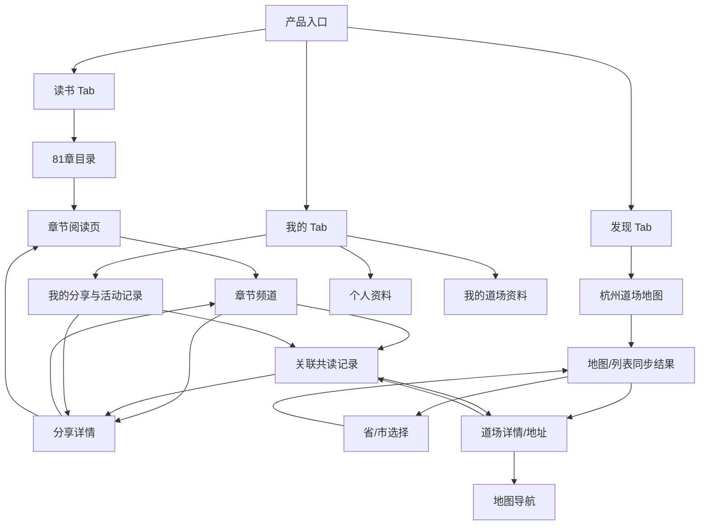
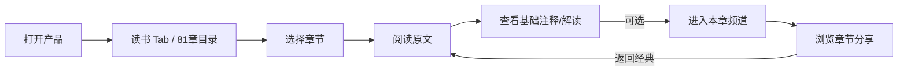
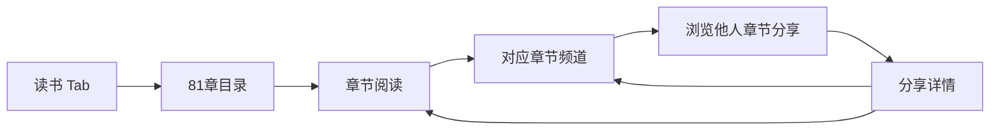
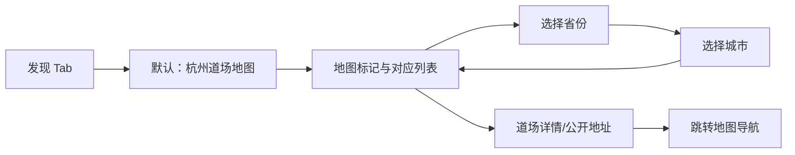
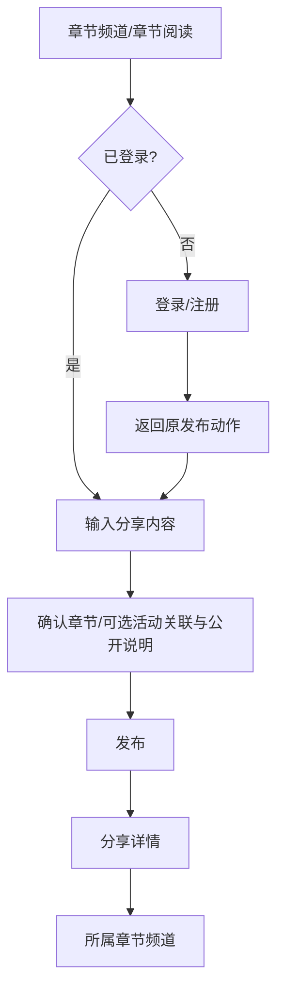
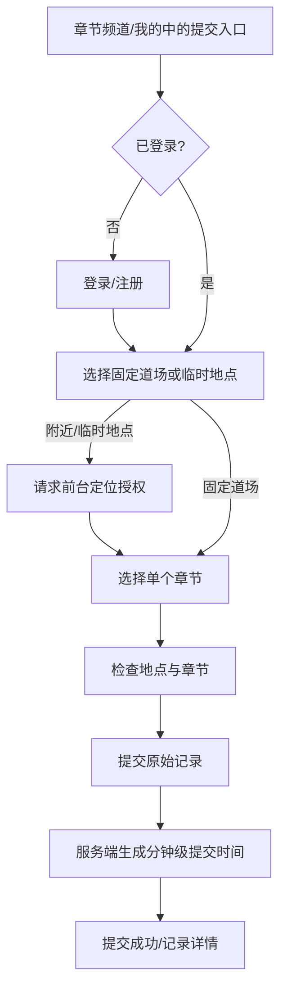

# 《道德经》共读平台：产品页面地图与动线 Spec

- 状态：讨论稿 v0.1
- 日期：2026-10-31
- 依据：[主产品 Spec](./proposal-spec.md)、[设计指导原则](./design-guidelines-spec.md)、[技术架构 Spec](./technical-architecture-spec.md)
- 目的：明确首期页面职责、页面间关系、用户动线和跨端信息框架，作为线框图与交互原型的输入
- 适用范围：响应式 Web 的移动端优先布局；不定义品牌视觉、高保真样式或 API 字段细节

## 1. 页面框架结论

一级导航为三个 Tab：**读书、发现、我的**。移动端打开产品默认进入“读书”；桌面端使用相同的主导航，但可将章节目录、正文和辅助信息并排呈现。

- **读书**是核心任务入口：目录 → 章节阅读 → 对应章节频道。
- **发现**首期只做道场到场发现：默认地图模式，可切换列表并按省/市查看地址；内容信息流、洞察推荐和其他主动内容发现暂不进入 MVP。
- **我的**管理用户资料和本人贡献：分享、活动记录、道场资料以及隐藏/删除等操作。
- **81 个章节频道**是按章节预置的稳定内容空间，不是活动频道。
- **活动记录、内容分享、道场资料**是不同业务对象，通过明确关联连接。一次活动读多个章节时，按章节分别提交记录。

## 2. 角色和访问基线

| 角色/状态 | 可浏览经典与公开内容 | 可发布分享 | 可提交活动记录 | 可维护道场资料 |
| --- | --- | --- | --- | --- |
| 未登录访客 | 可以 | 不可以；提示登录后继续 | 不可以；提示登录后继续 | 不可以 |
| 已登录用户 | 可以 | 可以，默认公开，可发布后隐藏 | 可以；单条提交对应一个章节，服务端生成分钟级提交时间 | 创建者/主理人按权限维护 |
| 平台管理员/运营 | 可以 | MVP 不提供专用管理端 | MVP 不提供审核/合并后台 | 必要维护由项目负责人通过受控数据库操作完成 |

**定位行为**

- 道场地图和省市列表浏览不要求设备定位；MVP 不提供发现页附近距离排序。
- 活动记录如选择临时地点，需要用户主动授权一次前台定位；拒绝授权时仍可改选固定道场记录。
- 不做后台持续定位。

## 3. 全局信息架构

## 4. 页面清单与页面职责

| ID | 页面 | 所属 Tab/层级 | 页面核心定位 | 关键出口 |
| --- | --- | --- | --- | --- |
| R01 | 读书首页/章节目录 | 读书 Tab | 展示 1—81 章目录、继续阅读位置和阅读入口 | 章节阅读、章节频道 |
| R02 | 章节阅读 | 读书二级页 | 阅读指定版本的原文、基础注释和解读 | 上/下一章、目录、章节频道、发现 |
| R03 | 章节频道 | 读书二级页 | 聚合该章相关分享和内容；显示章节上下文 | 阅读本章、分享详情、发布分享（登录） |
| D01 | 发现道场（地图/列表） | 发现 Tab | 地图为默认视图；按省/市筛选已收录固定道场 | 道场详情、地图外跳 |
| D02 | 省/市选择与道场列表 | 发现二级页/状态 | 按省、市逐级选择并浏览道场地址 | 道场地图状态、道场详情 |
| C01 | 分享详情 | 通用内容页 | 展示分享正文/媒体、作者、来源、章节和活动关联 | 所属章节频道、关联活动记录 |
| C02 | 发布分享 | 登录后的轻量编辑页/弹层 | 发布一段文字或媒体分享，章节可从当前上下文预填 | 分享详情、对应章节频道 |
| G01 | 活动记录提交 | 登录后的轻量流程 | 提交已发生的单章节共读记录；不管理报名签到 | 提交成功/活动记录详情、章节频道 |
| G02 | 活动记录详情 | 通用内容页 | 展示提交时间、章节、地点、内容关联和记录状态 | 章节频道、关联分享、道场详情 |
| V01 | 道场详情 | 通用内容页 | 展示道场地址、介绍、活动方式、公开联系方式和更新时间 | 地图外跳、关联活动/分享、维护资料（有权限） |
| M01 | 我的 | 我的 Tab | 个人资料入口与个人内容总览 | 我的分享、我的记录、道场管理、账号设置 |
| M02 | 我的内容 | 我的二级页 | 查看本人分享和活动提交，进入详情并管理 | 分享/活动详情、隐藏或删除操作 |
| M03 | 编辑个人/道场资料 | 我的二级页 | 编辑展示名或本人有权维护的道场资料 | 返回对应个人/道场详情 |
| A01 | 登录/注册/找回密码 | 受限操作入口 | 完成手机号或邮箱注册登录；邮箱注册账号通过邮箱找回，手机号账号须先绑定并验证恢复邮箱 | 返回用户原先尝试执行的动作 |

**首期明确不列为页面/功能的内容**：发现 Tab 的通用内容信息流/洞察卡片、个性化推荐、跨章节内容主动发现/筛选、活动报名与 RSVP、签到/二维码、未来活动日历、评论/话题讨论、关注/私信、运营精选管理、活动合并后台、统计看板、运营管理端、AI 问答。分享浏览仍属于读书路径：用户从章节阅读页进入对应章节频道，在频道内查看他人分享。

## 5. 核心页面信息框架

### R01 读书首页 / 章节目录

1. 顶部：产品名称/轻量导航、必要的账号入口。
2. 继续阅读：最近章节/阅读进度（首次访问时可不显示）。
3. 章节目录：第 1—81 章按序排列，显示章节号和版本中存在的章名。
4. 每章入口：主点击进入阅读；次级明确入口进入该章频道。
5. 目录状态：加载、空数据、章节内容暂不可用、最近阅读位置。

移动端以单列目录和连续滚动为主；桌面端可采用章节侧栏加阅读主栏。目录不混入推荐卡片流。

### R02 章节阅读

1. 章节导航：返回目录、章号/章名、上一章/下一章。
2. 原文区：所用版本及来源可见；文字为页面视觉主层级。
3. 基础注释/解读：清晰分区，避免和经典原文混排。
4. 阅读控制：字号、阅读进度/记忆、来源说明。
5. 章节频道入口：浏览本章分享；不得将个人体悟标成权威经义。

### R03 章节频道

1. 频道标题：章号/章名、阅读原文入口。
2. 章节分享流：按提交时间倒序呈现公开分享卡片，显示作者、提交时间、内容类型和来源；这是首期发现他人分享的主要入口。
3. 活动关联：可显示关联的已发生活动记录，但与分享内容分开标识。
4. 发布入口：已登录用户可发起分享，默认关联当前章；未登录用户触发登录并回到原操作。
5. 首期不提供话题、评论和成员名册；后续社交扩展不改变章节频道作为固定骨架。

### D01/D02 发现道场：地图与省市列表

1. **默认状态**：打开“发现”即显示道场地图，初始城市为杭州；不先展示分享流、洞察卡片或推荐内容。
2. **地图模式**：显示已收录、地址和坐标已核验的固定道场；一期重点覆盖杭州，并允许把地图平移/区域切换到浙江其他城市。
3. **列表模式**：地图与列表共用同一筛选结果。列表提供省份和城市的层级选择；一期默认浙江省 → 杭州市，并可继续选其他已收录省市。
4. **地图/列表联动**：选择标记或列表项时高亮同一道场；列表选择让地图定位该道场。地图缩小导致标记密集时聚合显示。
5. **道场卡片**：列表显示道场名称、城市/片区、活动方式和简短介绍；进入详情后查看公开地址、联系方式、最近更新时间和地图导航入口。
6. **覆盖范围**：杭州约 20 个道场是一期首批资料梳理目标，不是系统上限。上线前核验每个道场的名称、省市/区、公开地址、经纬度、坐标来源、活动方式、联系方式和资料更新时间。
7. **不在发现图层展示临时地点**：临时地点仍可作为活动记录地点，但不自动进入公开道场列表/地图；它不是固定道场资料。
8. **无需为城市浏览授权定位**：杭州地图和省市列表可直接浏览。后续如加入“定位我附近”，再单独请求设备位置权限；临时地点提交的定位授权仍沿用活动流程要求。

### C01/C02 分享详情与发布

- 分享详情显示内容类型、作者/整理者、来源、关联章节、关联活动、公开状态和发布时间。
- 发布最小路径为“输入内容 → 确认关联章节/公开说明 → 发布”；从章节频道发起时预选当前章节。
- 图片/音频/视频可选；上传前提示公开范围和第三方授权责任。
- 发布默认公开；用户可发布后隐藏自己的分享。MVP 没有评论/话题流，互动入口不显示假按钮。
- 成功后进入分享详情，并有回到章节频道的明确入口。

### G01/G02 活动记录提交与详情

- 提交对象是已发生的共读记录，不是未来活动。
- 提交路径：登录 → 选择固定道场或授权当前位置作为临时地点 → 选择一个章节 → 提交 → 服务端写入分钟级提交时间。
- 多章节活动逐章提交；不要求组织者确认、参与者确认、签到、报名或媒体证明。
- 活动记录详情标出章节、时间、地点来源和关联分享；原始提交独立保留，不展示为去重后的活动数。
- 记录时间是提交时刻，不提供活动发生时间回填；状态文字应表达记录状态（如“已提交”），不能显示报名/出席状态。

### V01 道场详情

- 展示名称、省市/区、介绍、活动方式、公开联系方式、公开地址、资料更新时间和地图导航入口。
- 道场资料由创建者/主理人维护；MVP 不提供地点归并或运营审核界面。
- 道场详情以到访所需的固定地址和资料为主；关联活动记录可作为次级信息，不扩展成发现页内容信息流。
- 地图导航外跳高德或百度；MVP 不显示产品自算路线/预计用时。

### M01/M02 我的与本人内容

- 我的首页显示账号资料入口、本人分享和活动记录入口、本人负责维护的道场入口。
- 手机号用户未绑定并验证恢复邮箱时，账号设置提示当前不能找回密码，并提供邮箱绑定/验证入口。
- 本人内容列表区分“分享”和“共读记录”，不把它们混成单一活动流。
- 分享支持隐藏/逻辑删除；记录的更正/删除申请能力需遵循主 Spec 当前承诺，不能误显示未实现的后台申请流程。
- 账号登录后返回用户原始目标页面/动作；账号切换或退出时清理受保护页面的用户状态。

## 6. 页面动线图

### 6.1 阅读主路径（产品主路径）

### 6.2 从章节频道发现分享

### 6.3 道场发现

### 6.4 发布分享与登录回跳

### 6.5 共读记录提交

## 7. 移动端与桌面端框架

| 区域 | 移动端 | 桌面端 |
| --- | --- | --- |
| 全局导航 | 底部三 Tab：读书、发现、我的；默认读书 | 顶部主导航；不新增“首页”一级入口 |
| 读书目录/阅读 | 单列目录/正文；目录抽屉或全页；触控优先 | 章节侧栏 + 有最大行宽的正文主栏 |
| 章节频道 | 单列分享流；作为发现本章他人分享的主要入口 | 频道主栏 + 章节/来源辅助信息 |
| 发现/道场发现 | 默认杭州地图；地图下方可收起列表面板；可切换省市列表 | 地图与道场列表并排；标记和列表选中状态同步 |
| 详情页 | 单列内容与关联对象 | 正文主栏 + 作者/章节/活动关联侧栏 |
| 我的 | 列表式资料和贡献管理 | 内容列表主栏 + 账户/维护信息侧栏 |

## 8. 页面状态与可测验收

- **读书首页**：新用户能从默认 Tab 找到指定章节；继续阅读位置可恢复；正文与分享类型可区分。
- **发现页**：打开后默认显示杭州道场地图；地图/列表切换结果一致；可按省市找到道场并查看公开地址，不混入分享推荐流。
- **章节频道**：频道章号清楚；分享与原文不混淆；用户能从阅读页进入频道查看他人分享；空频道可回到原文或发布首条分享。
- **登录回跳**：从受限操作触发登录后回到同一页面和原操作，避免要求用户重新寻找入口。
- **活动提交**：无需媒体或签到即可完成单章节记录；未登录、拒绝定位、缺少地点/章节、提交失败均有可恢复状态。
- **定位拒绝**：道场地图和省市列表仍可用；临时地点提交明确说明需要定位，并可返回改选固定道场。
- **道场地图/列表**：默认杭州地图；地图标记和列表项双向联动；首批约 20 个杭州道场逐一具备经核实坐标和资料更新时间；临时活动地点不混入固定道场发现结果。
- **活动语义**：已发生记录不出现报名/确认出席状态；未来活动能力未上线时不提供“日历报名”假入口。

建议在原型测试中测量：指定章节定位成功率 ≥ 90%；分享发布成功率 ≥ 90%；活动记录完成率 ≥ 90%，中位完成时间 ≤ 3 分钟；用户对“读书/发现”的任务判断正确率 ≥ 85%。这些是原型目标，不是已测结果。

## 9. 反向审视与待确认项

1. **“发现”是否保持单一定位？** MVP 只服务于线下道场到场发现；分享发现保留在章节频道，不把通用内容流或洞察推荐塞回该 Tab。
2. **频道 MVP 与社交愿景有阶段差异。** 当前主 Spec 的首期章节频道只支持分享浏览/发布，不做话题和评论。页面原型应按此收敛，不能因为频道名称而预设成熟社区功能。
3. **活动记录和内容分享不能互相替代。** 活动记录可无分享；分享可无活动；两者分别有发布入口和详情页，通过关系关联。
4. **定位受限时需有可理解回退。** 道场地图和省市列表不依赖定位；临时地点提交依赖一次定位授权，拒绝后仍可选择固定道场。
5. **地图是默认视图，列表是完整等价入口。** 地图不能成为查找道场的唯一方式；地图标记、列表筛选、城市范围和选中道场必须保持一致。
6. **杭州约 20 个是首批资料覆盖目标，不是地图容量上限。** 上线前需有逐项核实的固定道场清单和坐标来源，并验证地图坐标系与供应商转换。
7. **主 Spec 与旧设计指导原则存在历史差异。** 本文按主 Spec 当前首期定义：单章节提交、服务端提交时间、仅登录后写入、无评论/话题、无定位后台。进入高保真原型前应同步旧文档中的过期流程和字段口径。
8. **主页/默认页命名要统一。** 产品没有独立“首页”Tab；“读书”是默认入口，“发现”承载原首页内容浏览功能。页面标题、导航文案、路由名称需一致。

> 本 Spec 定义页面职责和流转，不替代具体组件设计。原型阶段应先验证阅读路径和“读书/发现”分工，再展开未来活动日历、成员关系或频道讨论等扩展。
