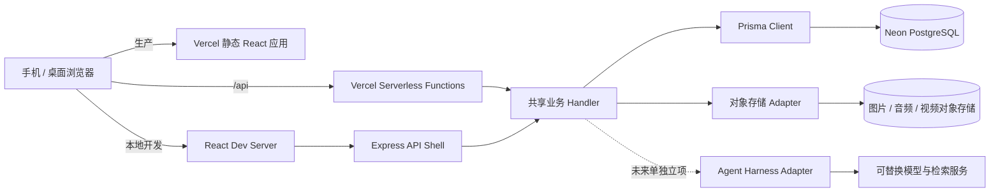

# 《道德经》公益共读平台技术架构 Spec

- 状态：架构规格讨论稿 v0.1
- 日期：2026-10-31
- 目标：形成实现前可评审、可拆分、可验收的技术基线
- 相关产品规格：[proposal-spec.md](./proposal-spec.md)

## 1. 架构摘要

平台采用与家谱项目相同的技术路线，降低团队学习和维护成本：

- **运行时：** Node.js
- **前端：** React 18 响应式单页应用，移动优先
- **生产托管：** Vercel 静态构建 + Serverless Functions
- **本地 API：** Express 作为开发传输层，与生产共用 API handler
- **数据访问：** Prisma
- **云数据库：** PostgreSQL，优先采用 Neon；应用连接使用池化连接串，数据库迁移使用直连连接串
- **认证：** 独立可复用的 `@daodejing/auth-kit` workspace 模块

该规格约束系统边界和模块职责，不要求首期就实现 AI Agent、统计后台、完整媒体处理流水线或全部地图能力。实际实现应按阶段交付，并保持接口可扩展。

## 2. 已确认的架构决策

| 领域 | 决策 | 影响 |
| --- | --- | --- |
| 应用运行 | Node.js + React 18 | 前后端使用 JavaScript/React 生态，沿用团队已熟悉的架构 |
| 生产部署 | Vercel | React 产物作为静态资源，API 使用 Serverless Functions |
| 本地开发 | React 开发服务器 + Express | Express 负责本地 `/api` 转发/传输，业务逻辑不复制到 Express |
| 数据库 | Prisma + PostgreSQL，采用 Neon；为道德经项目新建独立 Neon project/database，不共用家谱项目实例 | schema 和迁移纳入版本控制，数据库实例、连接凭据和数据边界与家谱项目隔离 |
| 认证模块 | 独立模块，可被多个项目复用 | 不在认证模块中创建道场、章节、共修活动等业务实体 |
| 注册登录 | 手机号或邮箱注册；手机号或邮箱加密码登录；邮箱用于密码找回 | 邮箱作为恢复方式时需要验证邮箱归属；短信/邮件模板使用家谱项目已验证的 provider 适配方式 |
| 共读活动 | 每次已登录用户提交都新增并计入一条原始记录；提交时由服务端记录分钟级时间 | 多章按章分别提交；MVP 不做去重、合并后台或十万次统计看板 |
| 定位 | 发现 Tab 的地图/省市列表不需要定位；临时地点提交需要设备定位授权 | 临时地点使用单次前台定位，不做持续追踪；MVP 不做附近排序 |
| 媒体 | 复用家谱项目验证过的媒体技术方案/代码适配方式 | 使用道德经项目独立媒体资源、桶、凭据和数据 |
| Agent Harness | 仅作为后续架构参考，不纳入产品 MVP 编码 | 当前不建设工程自动化 Harness、平台数据摄取或面向用户 AI |

## 3. 系统上下文



### 核心约束

1. Express 只用于本地开发；业务规则必须位于可被 Express 和 Vercel 共同调用的 handler/service 中。
2. 浏览器不得直连 PostgreSQL，也不得持有短信、邮件、对象存储或模型服务密钥。
3. 结构化业务资料进入 PostgreSQL；大型原始媒体进入对象存储，数据库只保存对象键、元数据和关系。
4. 模型供应商与 Agent Harness 通过接口隔离；不允许把供应商 SDK、提示词格式或向量数据格式写成业务实体的永久协议。
5. 权限检查在服务端完成；前端隐藏按钮不构成访问控制。

## 4. 仓库模块边界

目标目录结构：

```text
src/                         React 应用与页面
  app/                       路由、布局、页面级组合
  features/                  reading、dojo、gathering、contribution 等产品功能
  services/                  前端 API client
api/                         Vercel Serverless Functions 入口
server/                      本地 Express 传输层，不放业务规则
lib/                         Prisma client、共享 handler 和服务端业务模块
packages/auth-kit/           独立认证模块
prisma/                      领域 schema、迁移和 seed
public/                      静态文件
docs/                        产品与技术规格
```

### 模块职责

| 模块 | 负责 | 不负责 |
| --- | --- | --- |
| `auth-kit` | 注册、登录、身份绑定、验证码、密码恢复、JWT 与当前账号读取 | 道场成员关系、共修活动、产品权限角色 |
| `accounts/profile`（应用层） | 用户公开资料、展示名、用户对外可见状态 | 密码、验证码、JWT 密钥 |
| `reading` | 版本、章节、原文及版本来源 | 用户上传的共修表达 |
| `dojos` | 固定道场、临时地点、创建者/维护人和公开地点 | 共读次数合并逻辑 |
| `gatherings` | 用户提交的一条活动记录及其时间、地点、章节关联 | MVP 阶段强制现场签到或参与者二次确认 |
| `contributions` | 文字与媒体分享、作者、章节/活动关联、公开/隐藏状态 | 经典原文的权威版本管理 |
| `media` | 上传授权、媒体元数据、对象存储读写、派生文件关系 | 将大文件存进 PostgreSQL |
| `agent` | Harness、检索、引用和模型适配 | 绕开内容权限或替代审核流程 |

## 5. 认证与账号架构

认证模块规划为 `packages/auth-kit/` npm workspace，使当前 Web 应用和未来项目引用同一个模块版本；复用经验证的代码与 provider 适配经验，但使用道德经项目独立 Neon 数据库、密钥和服务配置。

### 5.1 认证能力

- 手机号验证码注册、邮箱验证码注册。
- 手机号或邮箱加密码登录。
- 忘记密码：邮箱注册账号使用已验证邮箱找回；手机号注册不要求注册时提供邮箱，个人资料设置可选绑定并验证恢复邮箱。
- 手机号账号尚未绑定已验证恢复邮箱时，须先登录并在个人资料中绑定、验证邮箱；完成后才可通过邮箱找回密码。不提供短信密码找回。
- JWT 由服务端签发；前端只保存访问令牌与最小用户展示资料。
- 所有密钥由服务端环境变量提供；独立 HMAC secret 用于身份标识散列，不把手机号明文放入身份索引键。
- 登录成功后的产品资料创建由应用层 hook 完成；认证模块不创建共修业务数据。

### 5.2 账号和产品资料分离

认证用户 ID 是跨模块稳定的内部主键。道场、内容、活动记录均引用该 ID，但不得把密码、JWT 或验证码字段复制进产品资料表。用户的公开资料与认证身份应分开管理。

MVP 用户可匿名浏览经文和公开内容；发布、提交活动和维护道场须登录。注册需验证手机号或邮箱；手机号注册时邮箱可后续选填绑定并验证。展示名及其他产品资料由应用层管理。用户对外身份指公开 profile 字段；手机号、登录邮箱、验证码等认证/恢复信息不通过公开接口返回。用户删除账号、身份合并、第三方登录等不属于 auth-kit 首期保证范围。

### 5.3 MVP API 契约

认证动作由一个可拆分 handler 提供，路由入口采用 `/api/auth/:action`；Vercel rewrite 和本地 Express 都转到同一 handler。

| 动作 | 方法 | 用途 |
| --- | --- | --- |
| `register` | POST | 手机或邮箱验证码注册账号 |
| `login` | POST | 手机号或邮箱 + 密码登录 |
| `send-code` | POST | 邮箱注册、密码找回或找回邮箱验证 |
| `phone-send-code` | POST | 手机号注册 |
| `reset-password` | POST | 验证码校验并重设密码 |
| `me` | GET | 验证 JWT 并读取当前账号 |

API 应设置 no-store 响应头、限制验证码用途和格式、对发送频率与失败尝试限流，并对密码使用慢哈希。服务端错误日志不能记录密码、验证码或完整认证 token。

## 6. 数据层

### 6.1 云端 PostgreSQL

- 生产云数据库选用 Neon PostgreSQL，沿用家谱项目已采用的连接方式。
- 道德经项目使用单独的新建 Neon project/database，不共用家谱项目实例、schema、连接池、账号或凭据。仅复用同一服务商和 Prisma 接入方式。
- 应用连接使用池化连接串 `DATABASE_URL`。
- Prisma schema 迁移使用直连连接串 `DATABASE_URL_UNPOOLED`。
- 运行环境分别使用开发、Preview、Production 配置；数据库凭据不进入源码、前端 bundle 或共享的公开 `.env.example` 实值。
- 数据库迁移由明确的迁移步骤执行，不在 Vercel 静态构建过程中静默更改 schema。

### 6.2 领域实体的初步边界

- `UserAccount` / `AuthIdentity`：认证账号和验证过的登录身份。
- `TextEdition` / `Chapter`：经文版本与章内容，原文需带来源、版本和校对状态。
- `ChapterChannel`：与 `Chapter` 一对一的预置章节频道。首期为 81 个稳定频道，作为各章分享内容的长期内容空间；评论、话题讨论等互动形态不属于首期；频道不按活动创建。
- `Dojo`：固定道场资料，由创建者/主理人维护；地图使用的坐标需带坐标系、来源及核实状态/时间，避免将手工近似坐标误当成精确地址。
- `TemporaryPlace`：无固定道场 ID 的地点，维护人标记街道级可到达地址并公开展示；未来可申请归并/升级为道场。
- `GatheringSubmission`：每次登录用户提交生成的原始共读记录，服务端保存提交时刻（分钟级）、地点/道场及单个章节。同一活动多章需逐章提交；不保存可回填的活动发生时间。
- `Gathering`：MVP 可与原始提交记录保持一对一，不进行基于时间/地点/章节的去重或后台归并。未来统计如需去重，再引入独立的归并关系和审计字段。
- `PlannedEvent`（未来、需另行确认）：若产品支持未来活动发布、改期/取消和 RSVP，应新增计划活动实体及独立生命周期（计划中、报名开放、已满、已取消、已结束等），不得把尚未发生的活动伪装成 `Gathering` 已发生记录。届时列表/日历是同一活动数据的不同视图，状态必须对应生命周期；首期不实现未来活动日历或 RSVP。
- `ContentItem`：分享体悟、金句、生活洞察、文章、话题或回复等内容对象，含作者/整理者、内容类型、正文或媒体引用、可见性、授权状态、来源、创建/更新时间及审核状态。
- `ContentChapterLink`：`ContentItem` 与 `ChapterChannel` 的多对多关联，记录关联来源（用户选择、频道内发布默认关联、运营维护或未来系统建议）及是否经确认。频道内发布时默认关联当前章节，跨章节内容可关联多个章节。
- `ContentGatheringLink`：内容与活动的关联。分享可关联活动；活动可关联多条分享。不要把活动 ID 与章节频道 ID 混在同一个通用“channel”字段中。
- `ContentRelation`：回复、引用、派生等内容关系；关系类型应明确，便于权限继承、删除传播和来源展示。
- `MediaAsset`：道德经项目独立媒体存储中的对象元数据、上传者、对象存储键、媒体类型、公开/隐藏/逻辑删除状态；MVP 不生成 AI 派生物。
- `Consent`：授权主体、用途、范围、期限和撤回时间，可关联内容或媒体对象。
- `AuditEvent`：重要内容隐藏、更正、身份绑定、道场维护权变更和后台归并操作的审计轨迹。
- `FeedEvent` / `RecommendationFeedback`（后续）：推荐对象的曝光、点击及用户不感兴趣/隐藏等反馈；记录信号与排序版本，支持解释、评估和纠偏。

**实体关系与发现模块边界**

- `Chapter` 与 `ChapterChannel` 一对一；内容与章节频道多对多；活动与章节频道、道场及内容通过显式关系关联。章节频道、活动、内容是三类不同实体。
- 81 个章节频道为首期主骨架；未来可增加运营主题频道，但不改变活动独立建模的原则。
- 当前 `GatheringSubmission` 表示用户已提交的共读记录；服务端提交时间是记录时间，界面状态不显示报名/出席状态。未来计划活动须使用独立 `PlannedEvent` 生命周期。
- “读书”是核心且默认入口；分享浏览留在对应章节频道。“发现”首期只提供固定道场地图和省/市列表，不建设跨章节分享信息流、洞察推荐或附近定位排序。
- 未来若新增内容/活动推荐，召回和排序须服从内容可见性、授权、隐藏及删除状态，且保留作者、章节、活动和来源回链。个性化推荐不得成为权限旁路；系统生成的章节或活动关联先作为待确认建议。
- 共读数据在 MVP 逐次按原始提交沉淀；每次提交都计数，不执行重复判断或合并。提交时服务端记录分钟级时间，多章按章分别提交。十万次长期目标的去重统计口径后续确定。

## 7. 媒体与地理服务

### 7.1 媒体存储

图片、音频、视频存入道德经项目独立对象存储，PostgreSQL 仅存元数据和引用。可复用家谱项目的媒体技术实现，但不得复用其服务实例、桶、凭据或用户数据。上传使用服务端签名或受限上传授权；媒体发布后默认公开，发布者可手动隐藏。

对象存储供应商和容量限制需在编码计划的依赖核查中确定。应用通过 `MediaStorage` provider interface 调用独立资源；复用方案/代码不等于复用服务实例。

### 7.2 道场地点与导航

- 固定道场使用稳定的道场 ID 和由主理人维护的地址。
- 临时道场没有道场 ID 时创建独立临时地点记录，维护人可把地址标记为街道级、可导航到达的精确地址；地点在产品中公开显示。
- 发现 Tab 默认杭州地图和省市列表浏览固定道场，不申请设备定位；MVP 不做附近排序。
- 临时地点提交必须取得浏览器/设备定位授权；仅在用户前台提交时取得一次定位，不持续跟踪。临时地点不自动成为发现地图中的固定道场标记。
- 临时地点以设备真实定位为起点，可匹配最近固定道场；用户选择未收录位置时保存独立临时地点，并按街道级地址公开展示。
- 提供高德地图和百度地图导航跳转；MVP 不计算产品内路线和预计用时，不开发 turn-by-turn 导航。
- 地理编码/逆地理编码和最近道场匹配服务需在编码计划阶段核实供应商、坐标系与密钥方式。
- 道场发现页面首期默认打开地图并以杭州为初始区域，地图和列表读取同一组道场查询结果；移动端地图/列表切换，桌面端并排。杭州目前已知约 20 个道场作为首批数据核验目标，不作为查询或渲染上限。
- 地图渲染与定位/地图供应商通过应用层 adapter 隔离；Dojo 资料保存坐标系、坐标来源和核实状态。供应商坐标转换必须在进入地图前完成且保持来源可审计。
- 默认杭州视口及省/市列表浏览不获取用户当前位置；未来若加入附近排序，应作为单独功能请求定位权限。

## 8. Agent Harness 与知识库

### 8.1 设计方向

原始活动、分享、音视频转写、道场资料和经文版本可成为可授权知识源。接入内容先保留原始来源和发布者，再产生转写、摘要、向量索引等派生数据；派生物必须反向链接到源内容。

Harness 接口负责模型路由、检索工具白名单、访问策略、引用格式、日志、超时和成本控制。DeepSeek 是候选模型，不在本 Spec 中绑定唯一模型或 SDK。系统应允许后续更换模型与检索服务，而不用重写业务数据实体。

### 8.2 建议演进顺序

1. MVP：不对用户承诺 AI 问答；先实现结构化数据权限、对象存储、人工内容浏览和基础全文搜索接口。
2. 后续：经明确授权后做音视频转写和分享摘要，结果作为可审阅的派生内容。
3. 再后续：建设 RAG/Agent 问答，输出逐条引用和源链接，并严格按原内容可见性过滤召回结果。

AI 必须区分经典原文、校注、用户分享和模型生成。检索不足时明确说依据不足；不能把模型回答归因为禅桥老师或经典原文。用户默认公开内容的意愿不替代工具权限校验：隐藏的内容不能再被公开问答召回。

### 8.3 仍待选型

- Harness/Agent 框架与工具编排方式。
- 向量存储：MVP 先不单独引入，待检索需求和语料规模验证后决定是否使用 PostgreSQL 扩展或独立服务。
- 音视频转写、摘要和索引的异步任务/队列实现。
- 模型供应商、部署区域、用户数据是否发送到第三方模型服务。

## 9. 安全、隐私与可靠性原则

- 密钥仅保存在 Vercel Server 环境变量或受控本地 `.env`，不进入 `REACT_APP_*` 环境变量。
- 数据库操作均经 Prisma 服务端代码，不给浏览器数据库访问凭据。
- 所有资源读取/修改均检查当前账号和资源关系；随机 ID 不代替权限校验。
- 验证码限流、失败尝试锁定、重置账号枚举保护、JWT 过期策略在 auth-kit 中统一实现。
- 内容/媒体默认公开是当前产品决定；发布页面应清楚说明账号身份和现场媒体均可公开，并提供手动隐藏入口。
- 用户隐藏内容后，公开读取接口应立即停止返回该内容；逻辑删除后不再对外提供，也不得进入未来 AI 检索。
- 道场街道地址公开前由维护人确认该地址可公开、可到达；改址应保留审计信息。
- MVP 不建设运营管理后台或人员身份标记界面；后续管理端可支持人员标记，当前必要维护可通过受控数据库操作完成。
- 日志不记录密码、验证码、完整 JWT、对象存储签名 URL 或媒体内容。
- 数据备份、恢复、媒体删除传播和用户账号删除策略需在持久化数据上线前进入实施规格。

## 10. 环境与部署

### 本地开发

- React Dev Server 提供前端热更新。
- Express 提供本地 `/api/*` 传输和 CORS。
- API 业务 handler、Prisma client 和 auth-kit 与生产共用。
- 开发者使用独立 Neon 开发数据库或隔离 schema，不将本地请求直接指向生产数据。

### Vercel

- CRA/React 构建产物部署为静态资源。
- `api/**/*.js` 作为 Serverless Functions。
- Vercel Preview 与 Production 使用各自的 `DATABASE_URL`、`DATABASE_URL_UNPOOLED`、JWT/HMAC 和 provider secrets。
- 数据库迁移由人工/CI 的受控步骤明确触发；Vercel build 只生成 Prisma Client 和前端产物。
- 上传大媒体使用对象存储签名方式，不依赖 Function 临时文件长期保存。

## 11. MVP 技术验收标准

- 可用单一仓库命令启动 React + Express 本地开发服务；两者都调用共享 handler。
- Vercel 可构建并提供 React 静态应用、认证 API 和健康检查入口。
- 使用 Neon/PostgreSQL 完成认证表迁移，开发、Preview、Production 配置隔离。
- 手机号和邮箱注册、手机号或邮箱登录、验证码发送、邮箱恢复验证、密码重置跑通。
- auth-kit 不引用道场、共读、经典或家谱租户模型；应用可通过 hook 建立自己的 profile。
- 数据库 schema 迁移有版本记录；Vercel 构建不自动改生产数据结构。
- 没有 provider 凭据时认证 API 明确返回服务未配置，不生成可用于注册/恢复的开发验证码。
- 公开资料/媒体的发布与手动隐藏状态可由服务端持久化，并在查询时执行。

## 12. 尚待产品/技术负责人确定的问题

1. **对象存储实现选择：**媒体代码/适配方案可以复用家谱项目；需在编码计划准备阶段核实服务商、独立资源、容量和单文件限制。
2. **定位服务：**定位权限必须取得；地理编码、逆地理编码、最近道场匹配需核实供应商 API、坐标系、密钥及浏览器限制。
3. **原文来源：**从网络选用一份可用王弼本作为初始文本，需登记来源 URL、版本、访问日期和许可说明，并独立存入版本化数据，便于后续替换。
4. **运行栈核对：**Node.js + React 18 + Vercel + Prisma + Neon 已定方向；具体构建器、Node 版本、API 入口和 workspace 方式在编码计划准备阶段对照家谱项目实现并固定。
5. **隐私操作边界：**隐藏立即停止公开读取；逻辑删除保留 tombstone/必要关联但不对外返回，未来不得进入 AI 检索。删除保留期限与备份清理时限在数据上线前定。

## 13. 实施顺序

1. 先评审本 Spec 和第 12 节决策。
2. 建立独立 Neon project/database，并明确对象存储、Vercel 环境和密钥管理。
3. 完成基础应用 shell、数据库迁移和 auth-kit 集成。
4. 建立章节阅读和内容领域模型，再逐步建设道场、活动、分享与媒体流程。
5. 用 MVP 真实使用反馈决定十万次统计展示、后台合并、地图路线供应商和 AI Harness 的迭代优先级。

实施任务拆分与阶段验收见[技术编码计划书](./technical-implementation-plan.md)。具体表结构、页面交互、API 字段、对象存储生命周期、预算与服务商合同可在计划书和对应 Feature PRD / ADR 中细化。
