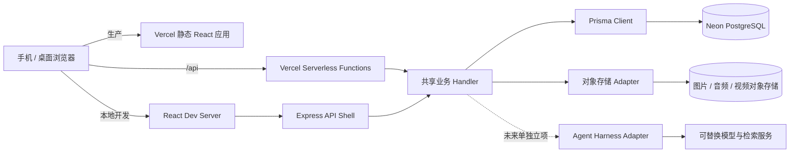

# 《道德经》公益共读平台技术架构 Spec

- 状态：技术基线 v1.0
- 日期：2026-11-01
- 更新：2026-11-03
- 目标：形成实现前可评审、可拆分、可验收的技术基线
- 相关产品规格：[proposal-spec.md](./proposal-spec.md)
- 决策优先级：产品功能、业务流程和定位以产品 Spec 为准；本文及技术实施计划约束实现方式。跨文档冲突先更新 Spec，不由编码者自行推断。

## 1. 架构摘要

平台采用与家谱项目相同的技术路线，降低团队学习和维护成本：

- **运行时：** Node.js
- **前端：** React 18 响应式单页应用，移动优先
- **生产托管：** Vercel 静态构建 + Serverless Functions
- **本地 API：** Express 作为开发传输层，与生产共用 API handler
- **数据访问：** Prisma
- **云数据库：** PostgreSQL，优先采用 Neon；应用连接使用池化连接串，数据库迁移使用直连连接串
- **认证：** 独立可复用的 `@daodejing/auth-kit` workspace 模块

该规格约束系统边界和模块职责，不要求首期就实现 AI Agent、统计后台、完整媒体处理流水线或全部地图能力。实际实现应按阶段交付，并保持接口可扩展。

## 2. 已确认的架构决策

| 领域 | 决策 | 影响 |
| --- | --- | --- |
| 应用运行 | Node.js + React 18 | 前后端使用 JavaScript/React 生态，沿用团队已熟悉的架构 |
| 生产部署 | Vercel | React 产物作为静态资源，API 使用 Serverless Functions |
| 本地开发 | React 开发服务器 + Express | Express 负责本地 `/api` 转发/传输，业务逻辑不复制到 Express |
| 数据库 | Prisma + PostgreSQL，采用 Neon；为道德经项目新建独立 Neon project/database，不共用家谱项目实例 | schema 和迁移纳入版本控制，数据库实例、连接凭据和数据边界与家谱项目隔离 |
| 认证模块 | 独立模块，可被多个项目复用 | 不在认证模块中创建道场、章节、共修活动等业务实体 |
| 注册登录 | 手机号或邮箱注册；手机号或邮箱加密码登录；手机号以短信验证码重置，邮箱账号以已验证邮箱重置 | 手机号账号每滚动 24 小时最多成功重置一次；邮箱作为备用恢复方式时须验证归属；短信/邮件模板使用家谱项目已验证的 provider 适配方式 |
| 共读活动 | 一次活动提交一个章节；每次已登录用户提交均保存原始记录；服务端自动记录分钟级时间 | 多人提交均保留；MVP 不合并、不展示提交数或十万次目标 |
| 定位/POI | 位置只用于关联有效 POI 并在地图展示；拒绝定位或未匹配有效 POI 时允许无地理信息提交 | 章节分享/频道不依赖地理位置；无 POI 内容不进入地图点位；不做附近排序 |
| 章节频道排序 | 有效阅读数是分享排序最高优先级 | 曝光与有效阅读分开采集；同一访客对同一分享按 Asia/Shanghai 自然日去重，阅读触发条件、访客键及异常流量规则在实现前定义 |
| 媒体 | 复用家谱项目验证过的媒体技术方案/代码适配方式 | 使用道德经项目独立媒体资源、桶、凭据和数据 |
| Agent Harness | 仅作为后续架构参考，不纳入产品 MVP 编码 | 当前不建设工程自动化 Harness、平台数据摄取或面向用户 AI |

未来自进化问题发现与优化方案见 [Agent Harness 自进化方案](./agent-harness-evolution-spec.md)。MVP-1 建议入口只持久化 VOC 数据，不启用自动化分析或执行。

## 3. 系统上下文



### 核心约束

1. Express 只用于本地开发；业务规则必须位于可被 Express 和 Vercel 共同调用的 handler/service 中。
2. 浏览器不得直连 PostgreSQL，也不得持有短信、邮件、对象存储或模型服务密钥。
3. 结构化业务资料进入 PostgreSQL；大型原始媒体进入对象存储，数据库只保存对象键、元数据和关系。
4. 模型供应商与 Agent Harness 通过接口隔离；不允许把供应商 SDK、提示词格式或向量数据格式写成业务实体的永久协议。
5. 权限检查在服务端完成；前端隐藏按钮不构成访问控制。

## 4. 仓库模块边界

目标目录结构：

```text
src/                         React 应用与页面
  app/                       路由、布局、页面级组合
  features/                  reading、dojo、gathering、contribution 等产品功能
  services/                  前端 API client
api/                         Vercel Serverless Functions 入口
server/                      本地 Express 传输层，不放业务规则
lib/                         Prisma client、共享 handler 和服务端业务模块
packages/auth-kit/           独立认证模块
prisma/                      领域 schema、迁移和 seed
public/                      静态文件
docs/                        产品与技术规格
```

### 模块职责

| 模块 | 负责 | 不负责 |
| --- | --- | --- |
| `auth-kit` | 注册、登录、身份绑定、验证码、密码恢复、JWT 与当前账号读取 | 道场成员关系、共修活动、产品权限角色 |
| `accounts/profile`（应用层） | 用户公开资料、展示名、用户对外可见状态 | 密码、验证码、JWT 密钥 |
| `reading` | 版本、章节、原文及版本来源 | 用户上传的共修表达 |
| `dojos` | 固定道场、临时地点、创建者/维护人和公开地点 | 共读次数合并逻辑 |
| `gatherings` | MVP：用户提交的一条原始活动记录及其时间、地点、章节关联；后续：以 `GatheringEvent` 活动实体聚合发起人、章节、道场、参与者、分组和记录素材 | 把报名/签到等同于录音授权；MVP 实现活动聚合、现场签到或参与者二次确认 |
| `contributions` | 文字与媒体分享、作者、章节/活动关联、外部来源、可见性、阅读事件、爱心、单层评论 | 经典原文的权威版本管理 |
| `media` | 上传授权、媒体元数据、对象存储读写、派生文件关系 | 将大文件存进 PostgreSQL |
| `agent` | Harness、检索、引用和模型适配 | 绕开内容权限或替代审核流程 |

## 5. 认证与账号架构

认证模块规划为 `packages/auth-kit/` npm workspace，使当前 Web 应用和未来项目引用同一个模块版本；复用经验证的代码与 provider 适配经验，但使用道德经项目独立 Neon 数据库、密钥和服务配置。

### 5.1 认证能力

- 手机号验证码注册、邮箱验证码注册。
- 手机号或邮箱加密码登录。
- 忘记密码：邮箱注册账号使用已验证邮箱找回；手机号账号使用短信验证码找回，手机号注册不要求注册时提供邮箱。个人资料可选绑定并验证恢复邮箱，作为替代找回方式。
- 手机号密码重置按账号限额：同一账号每滚动 24 小时最多成功重置一次；短信验证码发送另设成本与反滥用限流，所有限制由服务端执行并返回明确的可重试时间。
- JWT 由服务端签发；前端只保存访问令牌与最小用户展示资料。
- 所有密钥由服务端环境变量提供；独立 HMAC secret 用于身份标识散列，不把手机号明文放入身份索引键。
- 登录成功后的产品资料创建由应用层 hook 完成；认证模块不创建共修业务数据。

### 5.2 账号和产品资料分离

认证用户 ID 是跨模块稳定的内部主键。道场、内容、活动记录均引用该 ID，但不得把密码、JWT 或验证码字段复制进产品资料表。用户的公开资料与认证身份应分开管理。

MVP 用户可匿名浏览经文和公开内容；发布、提交活动和维护道场须登录。注册需验证手机号或邮箱；手机号注册时邮箱可后续选填绑定并验证。展示名及其他产品资料由应用层管理。用户对外身份指公开 profile 字段；手机号、登录邮箱、验证码等认证/恢复信息不通过公开接口返回。用户删除账号、身份合并、第三方登录等不属于 auth-kit 首期保证范围；MVP-1 不实现账号删除，数据默认沉淀。

### 5.3 MVP API 契约

认证动作由一个可拆分 handler 提供，路由入口采用 `/api/auth/:action`；Vercel rewrite 和本地 Express 都转到同一 handler。

| 动作 | 方法 | 用途 |
| --- | --- | --- |
| `register` | POST | 手机或邮箱验证码注册账号 |
| `login` | POST | 手机号或邮箱 + 密码登录 |
| `send-code` | POST | 手机/邮箱注册、手机短信密码重置、邮箱密码重置或恢复邮箱验证 |
| `phone-send-code` | POST | 手机号注册 |
| `reset-password` | POST | 验证码校验并重设密码 |
| `me` | GET | 验证 JWT 并读取当前账号 |

API 应设置 no-store 响应头、限制验证码用途和格式、对发送频率与失败尝试限流，并对密码使用慢哈希。服务端错误日志不能记录密码、验证码或完整认证 token。

## 6. 数据层

### 6.1 云端 PostgreSQL

- 生产云数据库选用 Neon PostgreSQL，沿用家谱项目已采用的连接方式。
- 道德经项目使用单独的新建 Neon project/database，不共用家谱项目实例、schema、连接池、账号或凭据。仅复用同一服务商和 Prisma 接入方式。
- 应用连接使用池化连接串 `DATABASE_URL`。
- Prisma schema 迁移使用直连连接串 `DATABASE_URL_UNPOOLED`。
- 运行环境分别使用开发、Preview、Production 配置；数据库凭据不进入源码、前端 bundle 或共享的公开 `.env.example` 实值。
- 数据库迁移由明确的迁移步骤执行，不在 Vercel 静态构建过程中静默更改 schema。

### 6.2 领域实体的初步边界

本节是领域概念清单。2026-11-03 已依据确认后的 MVP-1 基线独立完成[数据库实施设计](./mvp-1-database-design.md)，并建立 Prisma schema 与增量迁移。此前预研稿不构成实现依据；后续数据变更仍须先检查基线与权限边界。

- `UserAccount` / `AuthIdentity`：认证账号和验证过的登录身份。
- `UserProfile`：公开展示名和 `avatarPresetId` 等资料；MVP 提供约 10 个内置 Q 版《道德经》风格头像，初始头像自动分配、用户可在 Profile 更换。分享页面只展示基础名称与头像，手机号/邮箱等登录及恢复资料不公开。
- `TextEdition` / `Chapter`：经文版本与章内容，原文需带来源、版本和校对状态。
- `ChapterChannel`：与 `Chapter` 一对一的预置章节频道。首期为 81 个稳定频道，作为各章内容、爱心和评论的长期空间；频道不按活动创建。
- `Dojo`：固定道场资料，由创建者/主理人维护；地图使用的坐标需带坐标系、来源及核实状态/时间，避免将手工近似坐标误当成精确地址。
- `TemporaryPlace`：与创建它的活动提交一对一关联的临时地点，由到场发起人编辑/纠正并确认街道级可到达地址；MVP 不复用或归并地点。
- `GatheringSubmission`：每次登录用户提交生成的原始共读记录，服务端保存提交时刻（分钟级）、地点/道场及单个章节。一次活动仅提交一个章节；不保存可回填的活动发生时间。
- `Gathering`：MVP 不单独建合并后的活动主表；`GatheringSubmission` 本身就是一条独立单章节原始记录，不进行重复判断、后台归并或用户可见计数。
- `PlannedEvent`（未来、需另行确认）：若产品支持未来活动发布、改期/取消和 RSVP，应新增计划活动实体及独立生命周期（计划中、报名开放、已满、已取消、已结束等），不得把尚未发生的活动伪装成 `Gathering` 已发生记录。届时列表/日历是同一活动数据的不同视图，状态必须对应生命周期；首期不实现未来活动日历或 RSVP。
- `ContentItem`：章节分享（体悟、金句、生活洞察等）对象，含作者/整理者、内容类型、正文/媒体/来源链接、章节、可见性、有效阅读数、爱心关系、评论关系、创建/更新时间。仅外链元数据与用户提交内容入库；不抓取全网。公开卡片仅显示基础名称和头像。
- `Comment`：归属于一条章节分享，记录作者、正文、创建时间与公开/删除状态；MVP 单层评论，不支持楼中楼。
- 内容与活动在 MVP 通过 ContentItem.gathering_submission_id 关联；活动提交本身已有单个 chapter_id，禁止用通用 channel 字段混放活动 ID 与频道 ID。
- `ContentLike`：账号与分享的一条唯一爱心关系，可撤销；匿名用户可浏览，爱心与评论需登录。
- `ContentViewEvent` / view counter：有效阅读事件及可见计数；按账号或匿名访客对同一分享以 Asia/Shanghai 自然日去重，同日最多计一次、次日可再计一次，并过滤异常流量。
- `CommentRelation`（未来）：引用、回复等复杂评论关系；MVP 不支持楼中楼。
- `MediaAsset`：道德经项目独立媒体存储中的对象元数据、上传者、对象存储键、媒体类型、公开/隐藏/逻辑删除状态；MVP 不生成 AI 派生物。
- `PublicationAcknowledgement`：记录发布者确认的公开范围/媒体告知版本；不等同于第三方实际授权证据。未来 AI/其他新增用途授权需单独评估，不属于 MVP。
- `AuditEvent`：重要内容隐藏、更正、身份绑定、道场维护权变更和后台归并操作的审计轨迹。
- `ContentExposure / EffectiveReadSignal`：记录频道内有效阅读、爱心和评论互动；MVP 分享排序仅以有效阅读数降序为主排序，评论计数仅展示/留存，不构建跨章节推荐。
- AI 使用边界：互动数据可用于产品活跃度分析；模型训练、自动摘要或语义挖掘不属于 MVP，须额外授权、用途说明和删除传播。

**实体关系与发现模块边界**

- `Chapter` 与 `ChapterChannel` 一对一；MVP 的 `ContentItem` 和 `GatheringSubmission` 各自关联一个 `Chapter`，分享可选关联一条活动提交和一个道场。章节频道、活动提交、分享、爱心和评论是不同实体。
- 81 个章节频道为首期主骨架；未来可增加运营主题频道，但不改变活动独立建模的原则。
- 当前 `GatheringSubmission` 表示用户已提交的共读记录；服务端提交时间是记录时间，界面状态不显示报名/出席状态。未来计划活动须使用独立 `PlannedEvent` 生命周期。
- “读书”是核心且默认入口；分享浏览、章节内有效阅读数排序和轻互动留在对应章节频道。“发现”首期提供固定道场和有效 POI 临时地点的地图及省/市列表，不建设跨章节分享流或个性化推荐。
- 频道分享默认按有效阅读数降序排序，并可提供“最新”视图。曝光与有效阅读分开统计。所有统计和排序须过滤隐藏/删除内容，保留章号、作者和来源回链。
- 评论须有基础限流、用户删除本人评论、屏蔽不可见分享及不当内容反馈入口；公开查询仅返回公开分享下的有效评论。
- 评论及互动事件须有稳定 ID、章节/分享归属和删除状态，以便后续研究活跃讨论；MVP 不计算单条评论活跃分，不提供评论爱心/回复。禁止将公开发布默认为 AI 训练授权。
- 共读数据在 MVP 逐次按原始提交沉淀；一次活动提交一个章节，多人提交分别保留。不执行重复判断或合并，也不在产品页面展示提交数。服务端记录分钟级提交时间；十万次是后置审计目标，统计口径后续确定。

## 7. 媒体与地理服务

### 7.1 媒体存储

图片、音频、视频存入道德经项目独立对象存储，PostgreSQL 仅存元数据和引用。可复用家谱项目的媒体技术实现，但不得复用其服务实例、桶、凭据或用户数据。上传使用服务端签名或受限上传授权；媒体发布后默认公开，发布者可手动隐藏。

对象存储供应商和容量限制需在编码计划的依赖核查中确定。应用通过 `MediaStorage` provider interface 调用独立资源；复用方案/代码不等于复用服务实例。

### 7.2 道场地点与导航

- 固定道场使用稳定的道场 ID 和由主理人维护的地址。
- 临时道场没有道场 ID 时创建独立临时地点记录，维护人可把地址标记为街道级、可导航到达的精确地址；地点在产品中公开显示。
- 发现 Tab 默认杭州地图和省市列表浏览固定道场及有有效 POI 的临时地点，区分类型且不申请设备定位；MVP 不做附近排序。
- 定位仅用于选择/匹配有效 POI 并展示地图点；不持续跟踪。拒绝定位或没有有效 POI 时，允许记录/分享不带地理位置，不影响章节频道归属和发布。
- 响应式 Web 仅在用户主动关联 POI 时使用浏览器 Geolocation API 请求一次定位；用户可拒绝且不影响章节内容提交。生产站点使用 HTTPS。
- 只有经确认的有效 POI 才建立地图关联；不得将未经用户确认的近似坐标当作有效 POI。地图/POI 方案复用已验证实现，具体字段与确认交互在 POI Slice 中定义。
- 提供高德地图和百度地图导航跳转；MVP 不计算产品内路线和预计用时，不开发 turn-by-turn 导航。
- 地理编码/逆地理编码和最近道场匹配服务需在编码计划阶段核实供应商、坐标系与密钥方式。
- 道场发现页面首期默认打开地图并以杭州为初始区域，地图和列表读取同一组道场查询结果；移动端地图/列表切换，桌面端并排。杭州目前已知约 20 个道场作为首批数据核验目标，不作为查询或渲染上限。
- 地图渲染与定位/地图供应商通过应用层 adapter 隔离；Dojo 资料保存坐标系、坐标来源和核实状态。供应商坐标转换必须在进入地图前完成且保持来源可审计。
- 默认杭州视口及省/市列表浏览不获取用户当前位置；未来若加入附近排序，应作为单独功能请求定位权限。

## 8. Agent Harness 与知识库

### 8.1 设计方向

原始活动、分享、音视频转写、道场资料和经文版本可成为可授权知识源。接入内容先保留原始来源和发布者，再产生转写、摘要、向量索引等派生数据；派生物必须反向链接到源内容。

Harness 接口负责模型路由、检索工具白名单、访问策略、引用格式、日志、超时和成本控制。DeepSeek 是候选模型，不在本 Spec 中绑定唯一模型或 SDK。系统应允许后续更换模型与检索服务，而不用重写业务数据实体。

### 8.2 建议演进顺序

1. MVP：不对用户承诺 AI 问答；先实现结构化数据权限、对象存储、人工内容浏览和基础全文搜索接口。
2. 后续活动能力：将 `GatheringEvent` 作为活动领域主体，报名/签到、成员/小组和共读素材均通过稳定活动 ID 关联；具体数据关系见[线下共修流程与自愿记录概念 Spec](./offline-gathering-capture-concept-spec.md)。
3. 后续媒体能力：经明确授权后做音视频转写和分享摘要，结果作为可审阅的派生内容；原始录制、转写草稿、个人认领收获和已发布分享必须区分状态与权限。
4. 再后续：建设 RAG/Agent 问答，输出逐条引用和源链接，并严格按原内容可见性过滤召回结果。

AI 必须区分经典原文、校注、用户分享和模型生成。检索不足时明确说依据不足；不能把模型回答归因为禅桥老师或经典原文。用户默认公开内容的意愿不替代工具权限校验：隐藏的内容不能再被公开问答召回。

针对线下录音，活动记录、整场录音及经校对的整理稿默认公开；“说话人 A/B”分段不得用于推断真实身份。语音识别或大模型整理产物必须保留来源媒体、作者、章节、活动和环节关联，并经人工校对后公开。活动内容默认公开不等于自动授权模型训练；摘要、索引或问答等模型处理用途按具体功能说明。见[线下共修流程与自愿记录概念 Spec](./offline-gathering-capture-concept-spec.md)。

### 8.3 仍待选型

- Harness/Agent 框架与工具编排方式。
- 向量存储：MVP 先不单独引入，待检索需求和语料规模验证后决定是否使用 PostgreSQL 扩展或独立服务。
- 音视频转写、摘要和索引的异步任务/队列实现。
- 模型供应商、部署区域、用户数据是否发送到第三方模型服务。

## 9. 安全、隐私与可靠性原则

- 密钥仅保存在 Vercel Server 环境变量或受控本地 `.env`，不进入 `REACT_APP_*` 环境变量。
- 数据库操作均经 Prisma 服务端代码，不给浏览器数据库访问凭据。
- 所有资源读取/修改均检查当前账号和资源关系；随机 ID 不代替权限校验。
- 验证码限流、失败尝试锁定、重置账号枚举保护、手机号账号每滚动 24 小时一次成功重置的额度、额度并发原子扣减及 JWT 过期策略在 auth-kit 中统一实现。
- 内容/媒体默认公开是当前产品决定；发布页面应清楚说明账号身份和现场媒体均可公开，并提供手动隐藏入口。
- 用户隐藏内容后，公开接口及每次媒体读取均须查询数据库最新的内容和媒体显隐状态，立即拒绝后续读取；逻辑删除后不再对外提供，也不得进入未来 AI 检索。不得通过可绕过状态检查的公开对象 URL、未撤销签名 URL 或缓存访问媒体；已下载文件不在服务器撤回能力范围内。
- 道场街道地址公开前由维护人确认该地址可公开、可到达；改址应保留审计信息。
- MVP 不建设运营管理后台或人员身份标记界面；后续管理端可支持人员标记，当前必要维护可通过受控数据库操作完成。
- 日志不记录密码、验证码、完整 JWT、对象存储签名 URL 或媒体内容。
- MVP-1 不实现账号删除等逆向流程，业务数据默认持续沉淀；内容创建者可管理本人内容，管理员可管理全部内容。公开内容的隐藏/逻辑删除只影响公开访问，并记录必要审计。

## 10. 环境与部署

### 本地开发

- React Dev Server 提供前端热更新。
- Express 提供本地 `/api/*` 传输和 CORS。
- API 业务 handler、Prisma client 和 auth-kit 与生产共用。
- 开发者使用独立 Neon 开发数据库或隔离 schema，不将本地请求直接指向生产数据。

### Vercel

- CRA/React 构建产物部署为静态资源。
- `api/**/*.js` 作为 Serverless Functions。
- Vercel Preview 与 Production 使用各自的 `DATABASE_URL`、`DATABASE_URL_UNPOOLED`、JWT/HMAC 和 provider secrets。
- 数据库迁移由人工/CI 的受控步骤明确触发；Vercel build 只生成 Prisma Client 和前端产物。
- 上传大媒体使用对象存储签名方式，不依赖 Function 临时文件长期保存。

## 11. MVP 技术验收标准

- 可用单一仓库命令启动 React + Express 本地开发服务；两者都调用共享 handler。
- Vercel 可构建并提供 React 静态应用、认证 API 和健康检查入口。
- 使用 Neon/PostgreSQL 完成认证表迁移，开发、Preview、Production 配置隔离。
- 手机号和邮箱注册、手机号或邮箱登录、验证码发送、邮箱恢复验证、密码重置跑通。
- auth-kit 不引用道场、共读、经典或家谱租户模型；应用可通过 hook 建立自己的 profile。
- 数据库 schema 迁移有版本记录；Vercel 构建不自动改生产数据结构。
- 没有 provider 凭据时认证 API 明确返回服务未配置，不生成可用于注册/恢复的开发验证码。
- 公开资料/媒体的发布与手动隐藏状态可由服务端持久化，并在查询时执行。

## 12. 尚待产品/技术负责人确定的问题

1. **对象存储实现选择：**媒体代码/适配方案可以复用家谱项目；需在编码计划准备阶段核实服务商、独立资源、容量和单文件限制。
2. **定位/POI：**定位权限仅在用户主动关联 POI 时请求；拒绝定位不影响章节内容流程。实施前确认有效 POI 匹配和地图坐标系。
3. **原文来源：**当前初始结构化稿保存在 [`prisma/seed/daodejing.yaml`](../prisma/seed/daodejing.yaml)，来源标注为用户提供文本，包含 81 章原文和现代白话释义；不推定其属于王弼本或其他特定传本。首期使用此已提供数据，按数据源记录标注来源和校核状态，不擅自更换或宣称已确认为特定底本。注解须标记为平台编辑释义，与经典原文分开展示和存储。后续新增底本应作为独立 TextEdition 保存，不覆盖本稿。

4. **章节注释的两层来源：**阅读面板先显示青年易读白话，再显示河上公古文注释；白话未来可独立替换为经过确认的禅桥老师版本。种子中的 `youth_easy_read` 为白话候选，`heshanggong_interpretation` 是现代转述，不能充当古文原注。两层分别记录来源、署名、版本、许可与审核状态；河上公原注须补充经核对的底本和章节对应，未完成时显示待补。数据模型扩展见数据库 Spec，尚待实现。
4. **运行栈核对：**Node.js + React 18 + Vercel + Prisma + Neon 已定方向；具体构建器、Node 版本、API 入口和 workspace 方式在编码计划准备阶段对照家谱项目实现并固定。
5. **隐私操作边界：**隐藏立即停止公开读取；逻辑删除保留 tombstone/必要关联但不对外返回，未来不得进入 AI 检索。删除保留期限与备份清理时限在数据上线前定。

## 13. 实施顺序

1. 先评审本 Spec 和第 12 节决策。
2. 建立独立 Neon project/database，并明确对象存储、Vercel 环境和密钥管理。
3. 完成基础应用 shell、数据库迁移和 auth-kit 集成。
4. 建立章节阅读和内容领域模型，再逐步建设道场、活动、分享与媒体流程。
5. 用 MVP 真实使用反馈决定十万次统计展示、后台合并、地图路线供应商和 AI Harness 的迭代优先级。

实施任务拆分与阶段验收见[技术编码计划书](./technical-implementation-plan.md)。具体表结构、页面交互、API 字段、对象存储生命周期、预算与服务商合同可在计划书和对应 Feature PRD / ADR 中细化。
